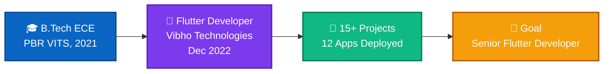
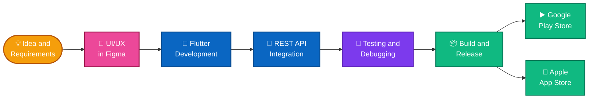
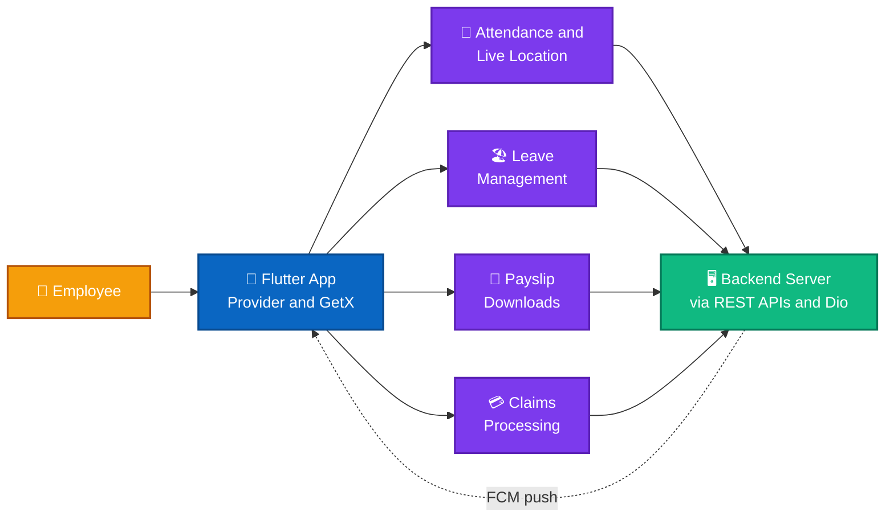
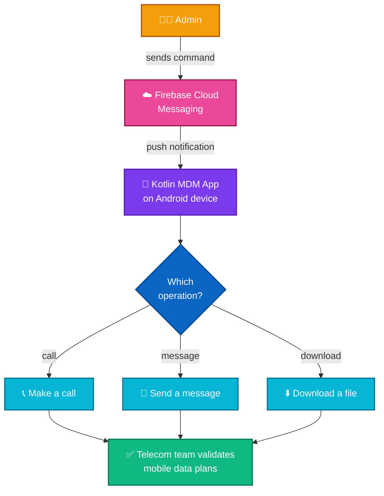

<!-- ===================================================================
  GitHub Profile README: Srinivas Alathur
  Theme: Blue & White with colorful accents
  Needs the folder "assets" (banner.svg, footer.svg, divider.svg) in the same repo.
  Tip: search for "UPDATE" in this file to find parts you may want to edit.
==================================================================== -->

<!-- ===================== HERO BANNER (animated) ===================== -->

<!-- Animated typing text: edit the lines= part to change the text -->

  

<!-- Quick contact badges -->

  

<!-- Impact numbers -->

## 👋 About Me

I am a passionate **Flutter Developer** with **5 years of experience** building cross-platform mobile applications for **Android and iOS**. I have worked on **15+ projects** across various domains, specializing in **Flutter, Kotlin, REST API integration, Node.js, and third-party integrations**. I enjoy solving technical challenges, developing user-friendly applications, and continuously learning new technologies to build scalable and reliable solutions.

- 📍 Based in **Hyderabad, Telangana, India**
- 💼 Flutter Developer at **Vibho Technologies Pvt Ltd**
- 🎓 B.Tech in Electronics & Communication Engineering, PBR VITS, Kavali (2021)
- 🎯 **Career goal:** Grow into a **Senior Flutter Developer** role at a product-based company, building scalable, high-quality mobile applications while strengthening my expertise in Kotlin, Node.js, and backend integration.
- 💡 **Interests:** Mobile app development, UI/UX design, learning new technologies, API integration, and exploring AI tools to improve application development
- ⚡ **Fun fact:** I've helped deploy **12 mobile apps**: **8 on the Google Play Store** and **4 on the Apple App Store**. I enjoy turning complex technical challenges into simple, reliable, and user-friendly mobile experiences. 🚀

### 🗺️ My Journey

## 💼 Work Experience

**Flutter Developer** · Vibho Technologies Pvt Ltd, Hyderabad · *Dec 2022 – Present*

- 📱 Build and ship cross-platform Flutter apps for Android and iOS, from feature development and debugging to store deployment
- 🔌 Integrate REST APIs and third-party services across multiple production applications
- 🚀 Deployed **12 apps** (8 on Google Play, 4 on the App Store) and built a **Kotlin-based Android MDM** automation app using push notifications

### ⚙️ How I Build Apps

## 🛠️ Tech Stack

<!-- UPDATE: add or remove badges here -->

 

 

**Core strengths:** Flutter Development • Kotlin / Android • Node.js • RESTful API Integration • Cross-platform Deployment • Third-party Integrations • Git Management • HTML, CSS, Bootstrap • C Programming • AI Tools • Figma • Mobile Automation / Push Notifications

## 🚀 Featured Projects

### 1️⃣ Vibho HCM: Human Capital Management App
Cross-platform Flutter app for employee management, with attendance check-in/check-out and live location tracking, leave management, payslip downloads, and claims processing.

- **Tech Stack:** Flutter, Dart, Provider, GetX, REST APIs, Dio, Firebase Cloud Messaging (FCM), Geolocation, Location-Based Services
- **Source:** 🔒 Private (company project)
- **Live:** [Google Play Store](https://play.google.com/store/apps/details?id=com.vibho.hcm) <!-- UPDATE: add your Apple App Store link here, e.g. | [App Store](https://apps.apple.com/...) -->

### 2️⃣ Plantation Manager
Agriculture and plantation management app covering farmer and farm lists, officer check-in/check-out, monthly plant growth updates, and live plus background location tracking for field officers.

- **Tech Stack:** Flutter, Dart, REST APIs, Geolocation, Background Location Tracking
- **Source:** 🔒 Private (company project)
- **Live:** [Google Play Store](https://play.google.com/store/apps/details?id=com.plantation.manager)

### 3️⃣ CGZA: Indian Global Connect
Community support app with SOS emergency alerts and live location sharing, nearby users and services, incident reporting, awareness videos, community posts with media, and multi-language support.

- **Tech Stack:** Flutter, Dart, REST APIs, Geolocation, Multi-language Support
- **Source:** 🔒 Private (company project)
- **Live:** [Google Play Store](https://play.google.com/store/apps/details?id=com.cgza.consulate)

### 4️⃣ MDM: Android Mobile Device Management
Android MDM app built with Kotlin that lets administrators remotely trigger device operations through push notifications, such as making calls, sending messages, and downloading files. It helps telecom testing teams automate device operations and validate different mobile data plans.

- **Tech Stack:** Kotlin, Android, Firebase Cloud Messaging (FCM), Push Notifications, Automation
- **Source:** 🔒 Private (company project)

## 📊 GitHub Stats

<!-- Private contributions are included (count_private=true).
     Remember to enable "Include private contributions on my profile" in your GitHub settings. -->

  

## 🏆 Achievements

- 🚀 Contributed to **15+ projects** across different domains
- 📱 Successfully deployed **12 mobile applications**: **8 on the Google Play Store** and **4 on the Apple App Store**
- 🔗 Delivered cross-platform mobile development and third-party API integrations
- 🤖 Built **Kotlin-based Android device-management automation** driven by push notifications

## 🤝 Open to Collaborate

I'm open to **full-time opportunities**, **freelance work**, and **open-source collaborations**, especially around:

- 📱 Flutter and mobile application development projects
- 💡 Innovative products that solve real problems
- 📈 Building scalable applications with **Flutter, Kotlin, and Node.js**

## 📫 Connect With Me

  

📧 **alathursrinivas1329@gmail.com**

 

<!-- Profile views counter -->

  

